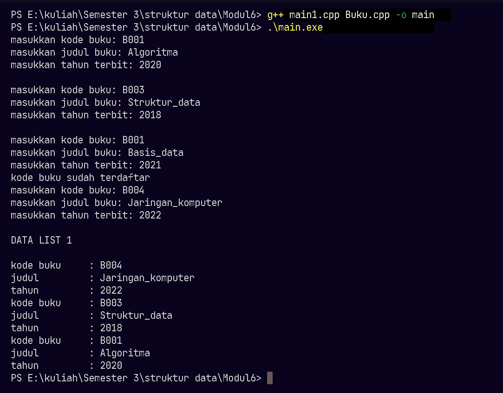
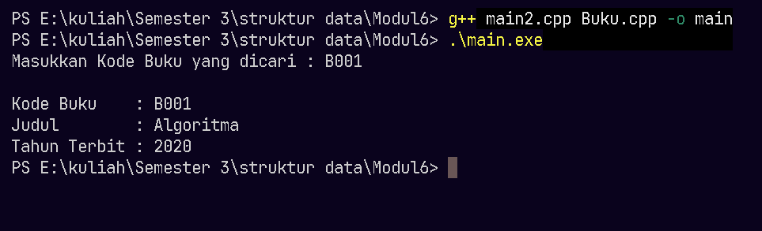
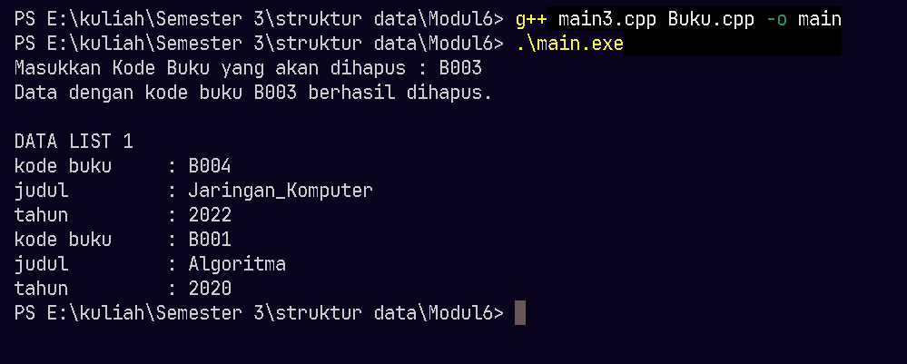

# <h1 align="center">Laporan Praktikum Modul 6 - Doubly Linked List (Bagian Pertama)</h1>
<p align="center">Hananto Widi Utomo - 109082500108 </p>

## Dasar Teori

### A. Doubly Linked List<br/>
Doubly linked list adalah linked list yang tiap elemennya punya dua successor: `prev` menunjuk elemen sebelumnya dan `next` menunjuk elemen sesudahnya [1]. List ini juga punya dua pointer utama, `first` yang menunjuk elemen pertama dan `last` yang menunjuk elemen terakhir [1]. List kosong terjadi ketika `first` bernilai `Nil` [1]. Dasarnya sama dengan linked list biasa, yaitu sejumlah node yang terhubung secara linier lewat pointer [2].

#### 1. Node dan Pointer
Setiap elemen berbentuk `struct` dengan tiga field: `info` untuk data, `next`, dan `prev` [1]. Pointer menyimpan alamat memori dan bernilai null bila tidak menunjuk ke mana pun [2]. `prev` elemen pertama dan `next` elemen terakhir bernilai `Nil`. Karena ada `prev`, program bisa menelusuri list maju dan mundur [1].

#### 2. Struktur List
Struct `list` menyimpan dua pointer, `first` dan `last` [1]. Pointer `last` membuat penambahan di akhir list tidak perlu menelusuri semua elemen dari awal.

### B. Operasi Insert<br/>
Semua insert diawali dengan `alokasi` untuk membuat elemen baru, lalu mengisi `next` dan `prev` elemen itu dengan `Nil` [1].

#### 1. Insert First
Elemen baru mengisi `next` dengan `first` lama, `prev` dari `first` lama diarahkan ke elemen baru, lalu `first` pindah ke elemen baru [1].

#### 2. Insert Last
Elemen baru mengisi `prev` dengan `last` lama, `next` dari `last` lama diarahkan ke elemen baru, lalu `last` pindah ke elemen baru [1].

#### 3. Insert After
Elemen baru mengambil `next` dari elemen `R` dan mengisi `prev` dengan `R`. Setelah itu `prev` dari elemen sesudah `R` dan `next` dari `R` diarahkan ke elemen baru [1]. Insert before bekerja sebaliknya, dan perbedaannya hanya pada cara mencari elemen [1].

### C. Operasi Delete<br/>
#### 1. Delete First
Pointer sementara `P` menampung elemen pertama, `first` pindah ke elemen berikutnya, lalu `prev` elemen pertama yang baru diisi `Nil` [1].

#### 2. Delete Last
`P` menampung elemen terakhir, `last` pindah ke elemen sebelumnya, lalu `next` elemen terakhir yang baru diisi `Nil` [1].

#### 3. Delete After
Elemen `P` berada setelah `R`. `next` dari `R` diisi `next` milik `P`, `prev` dari elemen sesudah `P` diarahkan ke `R`, lalu `next` dan `prev` milik `P` diisi `Nil` [1]. Setelah dilepas, elemen dikembalikan atau di-dealokasi [1].

### D. Searching, Update, dan View<br/>
Proses pencarian, update, dan view sama dengan singly linked list. Bedanya, doubly linked list mengakses elemen dengan lebih mudah karena iterasi bisa maju dan mundur [1]. Pencarian mengunjungi tiap elemen dan berhenti ketika elemen yang dicari ketemu [2].

### E. Pemisahan File pada ADT<br/>
ADT terbagi menjadi file header yang memuat tipe dan prototype, file implementasi yang memuat isi fungsi, dan program utama [3]. Prosedur boleh tidak mengembalikan nilai, sedangkan fungsi wajib mengembalikan nilai [3]. Parameter yang nilainya harus berubah di program pemanggil dikirim secara by reference [2].


## Guided 

### 1. Doublylist.h

```C++
#ifndef DOUBLYLIST_H
#define DOUBLYLIST_H

#include <iostream>
#include <string>

#define Nil NULL

// Latihan 1
struct infotype {
    std::string nopol; 
    std::string warna; 
    int thnBuat;      
};
typedef struct elmlist *address;
struct elmlist {
    infotype info;  
    address next;   
    address prev;   
};
struct List {
    address First; 
    address Last;  
};


// Latihan 1
void CreateList(List &L);
address alokasi(infotype x);
void dealokasi(address &P);
void printInfo(List L);
void insertLast(List &L, address P);

// Latihan 2

address findElm(List L, std::string nopol);

// Latihan 3
void deleteFirst(List &L, address &P);
void deleteLast(List &L, address &P);
void deleteAfter(List &L, address Prec, address &P);
void deleteElm(List &L, std::string nopol, bool &status);

#endif
```
File ini adalah header ADT doubly linked list. Baris `#ifndef DOUBLYLIST_H`, `#define DOUBLYLIST_H`, dan `#endif` membentuk header guard, sedangkan `#define Nil NULL` memberi nama `Nil` untuk pointer kosong.

`struct infotype` menyimpan data kendaraan: `nopol`, `warna`, dan `thnBuat`. `struct elmlist` punya tiga field, yaitu `info` bertipe `infotype`, `next`, dan `prev`. Keduanya bertipe `address`, yaitu pointer ke elemen sesudah dan sebelum. `struct List` menyimpan dua pointer, `First` ke elemen pertama dan `Last` ke elemen terakhir. Bagian bawah file memuat prototype semua prosedur dan fungsi, dikelompokkan per latihan.

### 2. Doublylist.cpp

```C++
#include "Doublylist.h"

// Latihan 1
void CreateList(List &L) {
    L.First = Nil;
    L.Last = Nil;
}

address alokasi(infotype x) {
    address P = new elmlist;
    P->info = x;
    P->next = Nil;
    P->prev = Nil; 
    return P;
}

void dealokasi(address &P) {
    delete P;
}

void printInfo(List L) {
    address P = L.Last;
    if (P == Nil) {
        std::cout << "List kosong." << std::endl;
        return;
    }
    while (P != Nil) {
        std::cout << "no polisi : " << P->info.nopol << std::endl;   
        std::cout << "warna     : " << P->info.warna << std::endl;   
        std::cout << "tahun     : " << P->info.thnBuat << std::endl; 
        P = P->prev;
    }
}

void insertLast(List &L, address P) {
    if (L.First == Nil) { 
        L.First = P;
        L.Last = P;
    } else {
        P->prev = L.Last;         
        (L.Last)->next = P;     
        L.Last = P;               
    }
}

// Latihan 2
address findElm(List L, std::string nopol) {
    address P = L.First;
    while (P != Nil) {
        if (P->info.nopol == nopol) {
            return P;
        }
        P = P->next;
    }
    return Nil;
}

// Latihan 3
void deleteFirst(List &L, address &P) {
    if (L.First == Nil) return;

    P = L.First; 
    if (L.First == L.Last) { 
        L.First = Nil;
        L.Last = Nil;
    } else {
        L.First = P->next;     
        (L.First)->prev = Nil; 
        P->next = Nil;         
    }
}

void deleteLast(List &L, address &P) {
    if (L.First == Nil) return;

    P = L.Last; 
    if (L.First == L.Last) { 
        L.First = Nil;
        L.Last = Nil;
    } else {
        L.Last = P->prev;      
        (L.Last)->next = Nil; 
        P->prev = Nil;         
    }
}

void deleteAfter(List &L, address Prec, address &P) {
    if (Prec == Nil || Prec->next == Nil) return;

    P = Prec->next;
    if (P == L.Last) {
        deleteLast(L, P);
    } else {
        Prec->next = P->next;     
        (P->next)->prev = Prec; 
        P->next = Nil;            
        P->prev = Nil;           
    }
}

void deleteElm(List &L, std::string nopol, bool &status) {
    address P = findElm(L, nopol);
    status = false;

    if (P != Nil) {
        if (P == L.First) {
            deleteFirst(L, P);
        } else if (P == L.Last) {
            deleteLast(L, P);
        } else {
            address Prec = P->prev;
            deleteAfter(L, Prec, P);
        }
        dealokasi(P); 
        status = true;
    }
}
```
File ini berisi isi prosedur yang dideklarasikan di `Doublylist.h`. `CreateList` mengisi `First` dan `Last` dengan `Nil` sehingga list kosong. `alokasi` membuat elemen baru dengan `new`, mengisi `info` dengan `x`, serta `next` dan `prev` dengan `Nil`. `dealokasi` mengembalikan memori elemen ke sistem dengan `delete`.

`insertLast` memeriksa list lebih dulu. Bila `First` bernilai `Nil`, elemen baru menjadi `First` sekaligus `Last`. Bila tidak, `prev` elemen baru diisi `Last` lama, `next` dari `Last` lama diarahkan ke elemen baru, lalu `Last` pindah ke elemen baru. `printInfo` mulai dari `Last` dan bergerak lewat `prev` sampai `Nil`, jadi data tampil dari elemen terakhir ke elemen pertama. List kosong menampilkan "List kosong.". `findElm` mulai dari `First`, menelusuri lewat `next`, dan mengembalikan alamat elemen dengan `nopol` yang sama atau `Nil` bila tidak ada.

Tiga prosedur delete melepas elemen dari list. `deleteFirst` memindahkan `First` ke elemen berikutnya dan mengisi `prev` elemen itu dengan `Nil`. `deleteLast` memindahkan `Last` ke elemen sebelumnya dan mengisi `next` elemen itu dengan `Nil`. Bila list hanya punya satu elemen, keduanya mengosongkan `First` dan `Last`. `deleteAfter` melepas elemen setelah `Prec` dengan mengisi `next` milik `Prec` dan `prev` milik elemen sesudahnya. Bila elemen itu ternyata `Last`, `deleteAfter` memanggil `deleteLast`.

`deleteElm` menggabungkan semuanya. Prosedur ini mencari alamat elemen dengan `findElm`, memilih `deleteFirst`, `deleteLast`, atau `deleteAfter` sesuai posisinya, memanggil `dealokasi`, lalu mengisi `status` dengan `true`. Bila elemen tidak ada, `status` tetap `false`.

### 3. main.cpp

```C++
#include <iostream>
#include "Doublylist.h"
using namespace std;

void inputData(List &L) {
    infotype data;
    address P;

    cout << "masukkan nomor polisi: "; cin >> data.nopol;
    cout << "masukkan warna kendaraan: "; cin >> data.warna;
    cout << "masukkan tahun kendaraan: "; cin >> data.thnBuat;
    if (findElm(L, data.nopol) == Nil) {
        P = alokasi(data); 
        insertLast(L, P);  
    } else {
        cout << "nomor polisi sudah terdaftar" << endl; 
    }
}

int main() {
    List L;
    CreateList(L); 
    address P;

    // Latihan 1
    inputData(L); 
    inputData(L); 
    inputData(L); 
    inputData(L); 

    cout << "\nDATA LIST 1" << endl; 
    printInfo(L); 

    // Latihan 2
    string nopolCari;
    cout << "\nMasukkan Nomor Polisi yang dicari : "; 
    cin >> nopolCari; 
    
    P = findElm(L, nopolCari); 
    if (P != Nil) {
        cout << "Nomor Polisi : " << P->info.nopol << endl; 
        cout << "Warna        : " << P->info.warna << endl; 
        cout << "Tahun        : " << P->info.thnBuat << endl; 
    } else {
        cout << "Data dengan nomor polisi " << nopolCari << " tidak ditemukan." << endl;
    }

    // Latihan 3
    string nopolHapus;
    bool hapusBerhasil;
    cout << "\nMasukkan Nomor Polisi yang akan dihapus : ";
    cin >> nopolHapus;

    deleteElm(L, nopolHapus, hapusBerhasil); 

    if (hapusBerhasil) {
        cout << "Data dengan nomor polisi " << nopolHapus << " berhasil dihapus." << endl; 
    } else {
        cout << "Data dengan nomor polisi " << nopolHapus << " tidak ditemukan." << endl;
    }
    cout << "\nDATA LIST 1" << endl; 
    printInfo(L); 

    return 0;
}
```
`main.cpp` memakai ADT dalam tiga tahap. Tahap pertama memanggil `inputData` empat kali. Prosedur ini membaca nomor polisi, warna, dan tahun, lalu mengecek lewat `findElm`. Nomor yang belum ada masuk list dengan `alokasi` dan `insertLast`. Nomor yang sudah ada memunculkan pesan "nomor polisi sudah terdaftar" dan datanya tidak masuk. `printInfo` kemudian menampilkan isi list dari elemen terakhir.

Tahap kedua membaca nomor polisi yang dicari. `findElm` mengembalikan alamat elemen, dan program menampilkan nomor polisi, warna, dan tahunnya. Bila hasilnya `Nil`, program menampilkan pesan tidak ditemukan.

Tahap ketiga membaca nomor polisi yang dihapus, lalu `deleteElm` melepas dan menghapus elemennya. Variabel `hapusBerhasil` menentukan pesan yang tampil. Terakhir `printInfo` menampilkan list yang tersisa.

## Unguided 

### 1. (Buatlah ADT Doubly Linked List di dalam file Buku.h, implementasi di dalam Buku.cpp, lalu coba di main1.cpp. Sistem harus mengecek duplikasi kodeBuku sebelum memasukkan data baru ke dalam list)

**Buku.h**
```C++
#ifndef BUKU_H_INCLUDED
#define BUKU_H_INCLUDED

#include <iostream>
#include <string>
using namespace std;

#define Nil NULL

struct buku {
    string kodeBuku;
    string judul;
    int thnTerbit;
};

typedef buku infotype;
typedef struct ElmList *address;

struct ElmList {
    infotype info;
    address next;
    address prev;
};

struct List {
    address First;
    address Last;
};

void createList(List &L);

address alokasi(infotype x);

void dealokasi(address &P);

void printInfo(List L);

void insertLast(List &L, address P);

address findElm(List L, infotype x);

void deleteFirst(List &L, address &P);

void deleteLast(List &L, address &P);

void deleteAfter(address Prec, address &P);

#endif
```

**Buku.cpp**
```C++
#include "Buku.h"

void createList(List &L) {
    L.First = Nil;
    L.Last = Nil;
}

address alokasi(infotype x) {
    address P = new ElmList;
    P->info = x;
    P->next = Nil;
    P->prev = Nil;
    return P;
}

void dealokasi(address &P) {
    delete P;
    P = Nil;
}

void printInfo(List L) {
    address P = L.Last;
    while (P != Nil) {
        cout << "kode buku     : " << P->info.kodeBuku << endl;
        cout << "judul         : " << P->info.judul << endl;
        cout << "tahun         : " << P->info.thnTerbit << endl;
        P = P->prev;
    }
}

void insertLast(List &L, address P) {
    if (L.First == Nil) {
        L.First = P;
        L.Last = P;
    } else {
        P->prev = L.Last;
        L.Last->next = P;
        L.Last = P;
    }
}

address findElm(List L, infotype x) {
    address P = L.First;
    while (P != Nil) {
        if (P->info.kodeBuku == x.kodeBuku) {
            return P;
        }
        P = P->next;
    }
    return Nil;
}

void deleteFirst(List &L, address &P) {
    if (L.First == Nil) {
        P = Nil;
    } else {
        P = L.First;
        if (L.First == L.Last) {
            L.First = Nil;
            L.Last = Nil;
        } else {
            L.First = P->next;
            L.First->prev = Nil;
            P->next = Nil;
        }
    }
}

void deleteLast(List &L, address &P) {
    if (L.First == Nil) {
        P = Nil;
    } else {
        P = L.Last;
        if (L.First == L.Last) {
            L.First = Nil;
            L.Last = Nil;
        } else {
            L.Last = P->prev;
            L.Last->next = Nil;
            P->prev = Nil;
        }
    }
}

void deleteAfter(address Prec, address &P) {
    if (Prec != Nil && Prec->next != Nil) {
        P = Prec->next;
        Prec->next = P->next;
        if (P->next != Nil) {
            P->next->prev = Prec;
        }
        P->next = Nil;
        P->prev = Nil;
    } else {
        P = Nil;
    }
}
```

**main1.cpp**
```C++
#include "Buku.h"

int main() {
    List L;
    createList(L);

    infotype x;
    int tersimpan = 0;

    while (tersimpan < 3) {
        cout << "masukkan kode buku: ";
        cin >> x.kodeBuku;
        cout << "masukkan judul buku: ";
        cin >> x.judul;
        cout << "masukkan tahun terbit: ";
        cin >> x.thnTerbit;

        if (findElm(L, x) != Nil) {
            cout << "kode buku sudah terdaftar" << endl;
        } else {
            insertLast(L, alokasi(x));
            tersimpan++;
            cout << endl;
        }
    }

    cout << "DATA LIST 1" << endl << endl;
    printInfo(L);
    return 0;
}
```
### Output Unguided 1 :

##### Output 1


penjelasan unguided 1
Soal ini meminta ADT Doubly Linked List untuk data buku dalam tiga file. `Buku.h` berisi struct `buku` (kode, judul, tahun terbit), tipe `infotype`, `address`, `ElmList`, `List`, dan prototype prosedur. `Buku.cpp` berisi isi prosedur, dan `main1.cpp` menjalankannya sebagai program utama. Struct `ElmList` punya field `info`, `next`, dan `prev`. Struct `List` menyimpan dua pointer, `First` dan `Last`.

`createList` mengisi `First` dan `Last` dengan `Nil` sehingga list kosong. `alokasi` membuat elemen baru dengan `new`, mengisi `info` dengan `x`, serta `next` dan `prev` dengan `Nil`. `dealokasi` menghapus elemen dari memori dengan `delete`. `insertLast` memeriksa list lebih dulu. Bila list kosong, `First` dan `Last` sama-sama menunjuk elemen baru. Bila tidak, `prev` elemen baru diisi `Last` lama, `next` dari `Last` lama diarahkan ke elemen baru, lalu `Last` pindah ke elemen baru. `printInfo` mulai dari `Last` dan bergerak lewat `prev` sampai `Nil`, sehingga data tampil dari elemen terakhir ke elemen pertama. Urutan ini sama dengan contoh output di soal.

Di `main1.cpp`, program membaca kode, judul, dan tahun terbit dari keyboard. Sebelum `insertLast`, `findElm` mencari kode yang sama di list. Bila `findElm` mengembalikan alamat, program menampilkan "kode buku sudah terdaftar" dan data itu tidak masuk list. Input B001, B003, B001 (duplikat), dan B004 menghasilkan tiga elemen. B004 masuk paling akhir, jadi tampil paling atas.

### 2. (Carilah elemen dengan kode buku B001 dengan membuat fungsi baru findElm(L : List, x : infotype) : address)

Soal ini memakai `Buku.h` dan `Buku.cpp` dari soal 1. Fungsi `findElm` ada di kedua file tersebut, dan program utamanya tersimpan di file terpisah.

**main2.cpp**
```C++
#include "Buku.h"

int main() {
    List L;
    createList(L);

    infotype x;
    x.kodeBuku = "B001"; x.judul = "Algoritma"; x.thnTerbit = 2020;
    insertLast(L, alokasi(x));
    x.kodeBuku = "B003"; x.judul = "Struktur_Data"; x.thnTerbit = 2018;
    insertLast(L, alokasi(x));
    x.kodeBuku = "B004"; x.judul = "Jaringan_Komputer"; x.thnTerbit = 2022;
    insertLast(L, alokasi(x));

    infotype cari;
    cout << "Masukkan Kode Buku yang dicari : ";
    cin >> cari.kodeBuku;
    cout << endl;

    address P = findElm(L, cari);
    if (P != Nil) {
        cout << "Kode Buku    : " << P->info.kodeBuku << endl;
        cout << "Judul        : " << P->info.judul << endl;
        cout << "Tahun Terbit : " << P->info.thnTerbit << endl;
    } else {
        cout << "Kode buku " << cari.kodeBuku << " tidak ditemukan" << endl;
    }
    return 0;
}
```
### Output Unguided 2 :

##### Output 1


penjelasan unguided 2
Soal kedua meminta fungsi `findElm` untuk mencari elemen berdasarkan kode buku. Fungsi menerima list `L` dan `x` bertipe `infotype`, lalu mengembalikan alamat elemen bila ketemu dan `Nil` bila tidak. Fungsi membandingkan `kodeBuku`, bukan seluruh isi `x`.

Di dalam `findElm`, pointer bantu `P` mulai dari `L.First`. Selama `P` bukan `Nil`, fungsi membandingkan `P->info.kodeBuku` dengan `x.kodeBuku`. Saat sama, fungsi mengembalikan `P`. Saat beda, `P` maju ke `P->next`. Kalau penelusuran mencapai `Nil` tanpa kecocokan, fungsi mengembalikan `Nil`. Soal 1 memakai fungsi yang sama untuk mengecek duplikasi.

Di `main2.cpp`, tiga buku (B001, B003, B004) masuk lewat `insertLast`. Program meminta kode dari keyboard, lalu `findElm` mencarinya. Untuk B001, hasilnya alamat elemen pertama, dan program menampilkan kode, judul, dan tahun terbit buku Algoritma. Bila kodenya tidak ada, program menampilkan pesan tidak ditemukan.

### 3. (Hapus elemen dengan kode buku B003 dengan membuat prosedur deleteFirst, deleteLast, dan deleteAfter)

Soal ini memakai `Buku.h` dan `Buku.cpp` yang sama. Tiga prosedur delete ada di kedua file tersebut, dan program utamanya tersimpan di file terpisah.

**main3.cpp**
```C++
#include "Buku.h"

int main() {
    List L;
    createList(L);

    infotype x;
    x.kodeBuku = "B001"; x.judul = "Algoritma"; x.thnTerbit = 2020;
    insertLast(L, alokasi(x));
    x.kodeBuku = "B003"; x.judul = "Struktur_Data"; x.thnTerbit = 2018;
    insertLast(L, alokasi(x));
    x.kodeBuku = "B004"; x.judul = "Jaringan_Komputer"; x.thnTerbit = 2022;
    insertLast(L, alokasi(x));

    infotype hapus;
    cout << "Masukkan Kode Buku yang akan dihapus : ";
    cin >> hapus.kodeBuku;

    address target = findElm(L, hapus);
    address P = Nil;

    if (target == Nil) {
        cout << "Data dengan kode buku " << hapus.kodeBuku << " tidak ditemukan." << endl;
    } else {
        if (target == L.First) {
            deleteFirst(L, P);
        } else if (target == L.Last) {
            deleteLast(L, P);
        } else {
            deleteAfter(target->prev, P);
        }
        dealokasi(P);
        cout << "Data dengan kode buku " << hapus.kodeBuku << " berhasil dihapus." << endl;
    }

    cout << endl << "DATA LIST 1" << endl;
    printInfo(L);
    return 0;
}
```
### Output Unguided 3 :

##### Output 1


penjelasan unguided 3
Soal ketiga meminta tiga prosedur delete. `deleteFirst` melepas elemen pertama. `P` menampung alamatnya, `First` pindah ke elemen berikutnya, dan `prev` elemen pertama yang baru diisi `Nil`. `deleteLast` melepas elemen terakhir dengan cara serupa. `P` menampung alamatnya, `Last` pindah ke elemen sebelumnya, dan `next` elemen terakhir yang baru diisi `Nil`. Kalau list hanya punya satu elemen, kedua prosedur mengisi `First` dan `Last` dengan `Nil`.

`deleteAfter` menerima elemen `Prec` dan melepas elemen yang ada setelahnya. `next` dari `Prec` diisi `next` milik elemen yang dilepas, dan `prev` elemen sesudahnya diarahkan ke `Prec`. Ketiga prosedur hanya melepas elemen dari list, jadi `main3.cpp` memanggil `dealokasi` untuk menghapusnya dari memori.

Di `main3.cpp`, program membaca kode yang akan dihapus, lalu `findElm` mencari alamatnya. Bila elemen itu sama dengan `First`, program memanggil `deleteFirst`. Bila sama dengan `Last`, program memanggil `deleteLast`. Selain itu elemen berada di tengah, dan program memanggil `deleteAfter` dengan elemen sebelumnya (`target->prev`) sebagai `Prec`. B003 berada di tengah, jadi `deleteAfter` yang bekerja. List tersisa B001 dan B004, dan `printInfo` menampilkan B004 lebih dulu karena penelusuran mulai dari `Last`.

## Kesimpulan
Praktikum Modul 6 membangun ADT Doubly Linked List. Tiap elemen punya pointer `next` dan `prev`, dan list menyimpan pointer `First` dan `Last`. Pada guided, ADT menyimpan data kendaraan. `insertLast` menambah elemen di akhir list setelah `findElm` memastikan nomor polisinya belum terdaftar, `printInfo` menampilkan data dari `Last` ke `First`, dan `deleteElm` memilih `deleteFirst`, `deleteLast`, atau `deleteAfter` sesuai posisi elemen. Pada unguided, ADT yang sama menyimpan data buku. `findElm` menolak kode buku ganda dan mencari B001, lalu B003 dihapus dengan `deleteAfter` karena berada di tengah list.


## Referensi
[1] Modul Praktikum Struktur Data. (t.t.). Modul 6: Doubly Linked List (Bagian Pertama). Purwokerto: Telkom University Purwokerto.
<br>[2] Triase. (2020). Struktur Data: Diktat Edisi Revisi. Medan: Fakultas Sains dan Teknologi, Universitas Islam Negeri Sumatera Utara. Diakses pada 2 November 2026 melalui http://repository.uinsu.ac.id/9717/.
<br>[3] Indahyanti, U., & Rahmawati, Y. (2020). Buku Ajar Algoritma dan Pemrograman dalam Bahasa C++. Sidoarjo: UMSIDA Press. Diakses pada 2 November 2026 melalui https://doi.org/10.21070/2020/978-623-6833-67-4.
