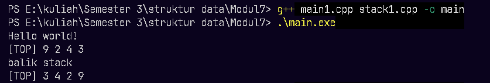
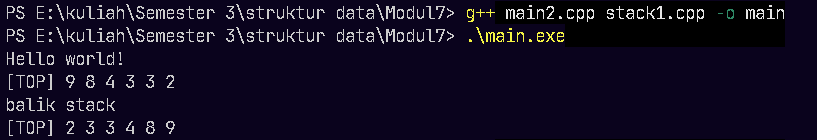
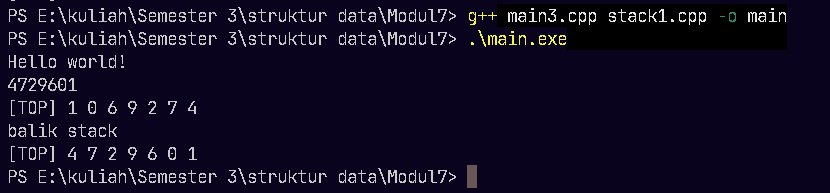

# <h1 align="center">Laporan Praktikum Modul 7 - Stack</h1>
<p align="center">Hananto Widi Utomo - 109082500108 </p>

## Dasar Teori

### A. Stack<br/>
Stack adalah struktur data yang bekerja seperti tumpukan. Elemen yang bisa diambil lebih dulu adalah elemen paling atas, dan prinsip ini disebut LIFO (Last In First Out) [1]. Triase mendefinisikan stack sebagai list linier yang elemen puncaknya (TOP) dikenali, dengan penyisipan dan penghapusan selalu dilakukan pada TOP [2]. Karena aturan itu, elemen yang ditambahkan paling akhir menjadi elemen yang pertama dihapus [2]. Stack banyak dipakai untuk pemanggilan prosedur, perhitungan ekspresi aritmatika, rekursif, dan backtracking [2].

#### 1. Stack dengan Representasi Pointer
Komponen stack pada dasarnya sama dengan singly linked list, hanya saja akses terhadap stack dilakukan pada awal stack saja [1]. Elemen stack berbentuk `struct elmStack` dengan field `info` dan `next`, sedangkan `struct stack` hanya menyimpan satu pointer, yaitu `Top` [1]. Stack kosong didefinisikan sebagai stack dengan `Top(S) = Nil` [2].

#### 2. Stack dengan Representasi Tabel
Representasi tabel pada prinsipnya sama dengan representasi pointer. Perbedaannya, data disimpan dalam array berindeks dan jumlah tumpukan terbatas sampai indeks `Imax` [1]. Pada materi, stack kosong ditandai dengan `Top = 0` [1][2]. Triase menyebut representasi tabel sangat tepat untuk stack karena penambahan dan pengurangan elemen hanya terjadi di salah satu ujung tabel [2]. Di bahasa pemrograman, stack biasanya ditempatkan pada array dengan satu variabel indeks yang menyatakan posisi TOP, dan stack serta array tetap dua hal yang berbeda [2]. Contoh Triase memakai `atas = -1` untuk stack kosong dan stack penuh bila `atas == maxstack-1` [2].

### B. Operasi pada Stack<br/>
Operasi utama stack ada dua, yaitu Push (penyisipan) dan Pop (pengambilan) [1]. Triase mendaftar empat operasi dasar: CREATE, ISEMPTY, PUSH, dan POP, serta definisi fungsional IsFull untuk menguji stack penuh [2].

#### 1. Push
Push menyisipkan elemen ke tumpukan dan sama dengan insert first pada list biasa [1]. Pada representasi pointer, elemen baru mengisi `next` dengan `S.Top`, lalu `S.Top` diarahkan ke elemen baru [1]. Pada representasi tabel, indeks `Top` digeser ke indeks berikutnya (`Top = Top + 1`) [1]. Elemen yang baru masuk menempati posisi TOP [2].

#### 2. Pop
Pop mengambil data pada posisi TOP dan mirip dengan delete first pada list linear [1]. Pada representasi pointer, `P` menampung `S.Top`, lalu `S.Top` pindah ke elemen berikutnya [1]. Pada representasi tabel, nilai `S.Info[TOP]` disimpan ke variabel sementara, lalu `TOP = TOP - 1` tanpa menghilangkan isi indeks sebelumnya [1]. Pop tidak bisa dipakai pada stack kosong dan dianggap kondisi error [2].

### C. Primitif dan ADT Stack<br/>
Primitif stack pada representasi tabel meliputi `createStack()`, `isEmpty()`, fungsi pencarian, dan primitif lain, yang tersimpan pada file `*.c` (pada praktikum ini berekstensi `.cpp`) dan file `*.h` [1]. Representasi tabel tidak memerlukan manajemen memori seperti `alokasi` dan `dealokasi` [1]. Menurut Triase, ADT mengemas struktur data sekaligus operasi yang dapat dilakukan terhadapnya [2]. Pembuatan dan pemakaian ADT bisa dilakukan terpisah, dan yang perlu disepakati hanyalah interface-nya [2].


## Guided 

### 1. Stack Representasi Tabel (stack.h, stack.cpp, main.cpp)

**stack.h**
```C++
#ifndef STACK_H_INCLUDED
#define STACK_H_INCLUDED

#include <iostream>
using namespace std;

struct infotype {
    char nim[20];
    char nama[20];
};
struct Stack {
    infotype info[10];
    int Top;
};

int isEmpty(Stack S);
void createStack(Stack &S);
void push(Stack &S, infotype X);
void pop(Stack &S, infotype &X);
void viewStack(Stack S);

#endif
```

**stack.cpp**
```C++
#include "stack.h"

int isEmpty(Stack S) {
    if (S.Top == 0) {
        return 0;
    } else {
        return 1;
    }
}

void createStack(Stack &S) {
    S.Top = 0;
}

void push(Stack &S, infotype X) {
    if (S.Top < 10) {
        S.Top = S.Top + 1;
        S.info[S.Top - 1] = X;
    } else {
        cout << "Stack penuh, data tidak bisa ditambahkan" << endl;
    }
}

void pop(Stack &S, infotype &X) {
    if (isEmpty(S) != 0) {
        X = S.info[S.Top - 1];
        S.Top = S.Top - 1;
    } else {
        cout << "Stack kosong, tidak ada data yang bisa diambil" << endl;
    }
}

void viewStack(Stack S) {
    if (isEmpty(S) == 0) {
        cout << "Stack kosong" << endl;
    } else {
        cout << "Isi stack (dari TOP):" << endl;
        for (int i = S.Top; i >= 1; i--) {
            cout << i << ". " << S.info[i - 1].nim << " - "
                 << S.info[i - 1].nama << endl;
        }
    }
}
```

**main.cpp**
```C++
#include <iostream>
#include <cstring>
#include "stack.h"
using namespace std;

int main() {
    Stack S;
    infotype data, hasil;

    createStack(S);
    cout << "Stack baru dibuat, Top = " << S.Top << endl;
    viewStack(S);

    cout << endl << "--- Push 3 data ---" << endl;
    strcpy(data.nim, "103112400001");
    strcpy(data.nama, "Andi");
    push(S, data);

    strcpy(data.nim, "103112400002");
    strcpy(data.nama, "Budi");
    push(S, data);

    strcpy(data.nim, "103112400003");
    strcpy(data.nama, "Citra");
    push(S, data);
    viewStack(S);

    cout << endl << "--- Pop 1 data ---" << endl;
    pop(S, hasil);
    cout << "Data yang diambil: " << hasil.nim << " - " << hasil.nama << endl;
    viewStack(S);

    cout << endl << "--- Pop sampai kosong ---" << endl;
    pop(S, hasil);
    pop(S, hasil);
    pop(S, hasil);
    viewStack(S);

    return 0;
}
```

penjelasan guided
Program ini mengimplementasikan ADT stack dengan representasi tabel, dibagi menjadi tiga file. `stack.h` memuat `struct infotype` (field `nim` dan `nama`), `struct Stack` yang berisi array `info` berukuran 10 dan penanda `Top`, serta prototype prosedur. `stack.cpp` memuat isi prosedur, dan `main.cpp` memuat program utama.

`createStack` mengisi `Top` dengan 0 sehingga stack kosong. `isEmpty` mengembalikan 0 bila `Top` sama dengan 0 dan mengembalikan 1 bila tidak, sesuai ketentuan pada materi bahwa nilai 0 berarti stack kosong [1]. `push` memeriksa dulu apakah `Top` masih di bawah 10. Bila ya, `Top` bertambah 1 dan data disimpan di `info[Top - 1]`, karena `Top` bernilai 1 sampai 10 sedangkan indeks array mulai dari 0. Bila penuh, program menampilkan pesan stack penuh. `pop` menyimpan `info[Top - 1]` ke parameter `X`, lalu `Top` berkurang 1, dan data lama tidak dihapus dari array. Bila stack kosong, program menampilkan pesan. `viewStack` menampilkan isi dari `Top` turun sampai 1, jadi elemen teratas tampil paling atas.

Di `main()`, stack dibuat lalu ditampilkan dalam keadaan kosong. Tiga data (Andi, Budi, Citra) di-push, sehingga Citra berada di TOP dan tampil pertama. Satu kali `pop` mengambil Citra, sehingga tersisa Budi dan Andi. Tiga kali `pop` berikutnya mengambil Budi dan Andi, dan pop yang ketiga mengenai stack kosong sehingga muncul pesan bahwa tidak ada data yang bisa diambil.

## Unguided 

### 1. (Buatlah ADT Stack menggunakan ARRAY di dalam file stack.h, implementasi di stack.cpp dan main.cpp, dengan prosedur createStack, push, pop, printInfo, dan balikStack)

Pada praktikum ini file ADT saya beri nama `stack1.h` dan `stack1.cpp` agar tidak bentrok dengan `stack.h` dan `stack.cpp` milik guided yang ada di folder yang sama. Isinya sesuai spesifikasi soal, yaitu `info` berupa array 20 integer dan `top` bertipe integer. Ketiga soal unguided memakai dua file ADT yang sama.

**stack1.h**
```C++
#ifndef STACK1_H_INCLUDED
#define STACK1_H_INCLUDED

#include <iostream>
using namespace std;

#define MAX 20

typedef int infotype;

struct Stack {
    infotype info[MAX];
    int top;
};

void createStack(Stack &S);
bool isEmpty(Stack S);
bool isFull(Stack S);
void push(Stack &S, infotype x);
infotype pop(Stack &S);
void printInfo(Stack S);
void balikStack(Stack &S);
void pushAscending(Stack &S, infotype x);
void getInputStream(Stack &S);

#endif
```

**stack1.cpp**
```C++
#include "stack1.h"

void createStack(Stack &S) {
    S.top = -1;
}

bool isEmpty(Stack S) {
    return S.top == -1;
}

bool isFull(Stack S) {
    return S.top == MAX - 1;
}

void push(Stack &S, infotype x) {
    if (isFull(S)) {
        cout << "stack penuh" << endl;
    } else {
        S.top++;
        S.info[S.top] = x;
    }
}

infotype pop(Stack &S) {
    if (isEmpty(S)) {
        cout << "stack kosong" << endl;
        return -1;
    }
    infotype x = S.info[S.top];
    S.top--;
    return x;
}

void printInfo(Stack S) {
    cout << "[TOP] ";
    for (int i = S.top; i >= 0; i--) {
        cout << S.info[i] << " ";
    }
    cout << endl;
}

void balikStack(Stack &S) {
    int i = 0;
    int j = S.top;
    while (i < j) {
        infotype temp = S.info[i];
        S.info[i] = S.info[j];
        S.info[j] = temp;
        i++;
        j--;
    }
}

void pushAscending(Stack &S, infotype x) {
    if (isFull(S)) {
        cout << "stack penuh" << endl;
    } else {
        int i = S.top;
        while (i >= 0 && S.info[i] > x) {
            S.info[i + 1] = S.info[i];
            i--;
        }
        S.info[i + 1] = x;
        S.top++;
    }
}

void getInputStream(Stack &S) {
    char c = cin.get();
    while (c != '\n') {
        if (c >= '0' && c <= '9') {
            push(S, c - '0');
        }
        c = cin.get();
    }
}
```

**main1.cpp**
```C++
#include "stack1.h"

int main() {
    cout << "Hello world!" << endl;
    Stack S;
    createStack(S);
    push(S, 3);
    push(S, 4);
    push(S, 8);
    pop(S);
    push(S, 2);
    push(S, 3);
    pop(S);
    push(S, 9);
    printInfo(S);
    cout << "balik stack" << endl;
    balikStack(S);
    printInfo(S);
    return 0;
}
```
### Output Unguided 1 :

##### Output 1


penjelasan unguided 1
Soal ini meminta ADT Stack berbasis array dengan prosedur `createStack`, `push`, `pop`, `printInfo`, dan `balikStack`. `stack1.h` memuat konstanta `MAX` bernilai 20, `typedef int infotype`, `struct Stack` yang berisi array `info` dan penanda `top`, serta prototype semua prosedur. `stack1.cpp` memuat isi prosedur, dan `main1.cpp` memuat program utama.

`createStack` mengisi `top` dengan -1 sehingga stack kosong. Nilai -1 saya pilih karena indeks array C++ mulai dari 0, dan Triase juga memakai `atas = -1` untuk stack kosong pada contoh programnya [2]. `isEmpty` dan `isFull` adalah primitif tambahan untuk memeriksa stack kosong dan penuh. `push` menaikkan `top` lalu menyimpan `x` di `info[top]`, dan menampilkan pesan bila stack sudah penuh. `pop` mengambil `info[top]`, menurunkan `top`, lalu mengembalikan nilai itu sebagai `infotype`. Bila stack kosong, `pop` menampilkan pesan dan mengembalikan -1. `printInfo` menampilkan isi stack dari `top` turun ke indeks 0, sehingga elemen teratas tampil pertama setelah tulisan `[TOP]`. `balikStack` menukar elemen indeks paling bawah dengan elemen indeks paling atas, bergerak ke tengah sampai kedua penunjuk bertemu.

Di `main1.cpp`, `push` 3, 4, 8 menghasilkan isi 3, 4, 8 dari bawah ke atas. `pop` pertama membuang 8. Setelah `push` 2 dan 3, isinya 3, 4, 2, 3, lalu `pop` kedua membuang 3, dan `push` 9 menghasilkan 3, 4, 2, 9. `printInfo` menampilkan `[TOP] 9 2 4 3`. Setelah `balikStack`, urutannya terbalik sehingga tampil `[TOP] 3 4 2 9`. Hasil ini sama dengan contoh output di soal.

### 2. (Tambahkan prosedur pushAscending(in/out S : Stack, in x : integer))

Soal ini memakai `stack1.h` dan `stack1.cpp` yang sama. Prosedur `pushAscending` sudah ada di kedua file tersebut, dan program utamanya tersimpan di file terpisah.

**main2.cpp**
```C++
#include "stack1.h"

int main() {
    cout << "Hello world!" << endl;
    Stack S;
    createStack(S);
    pushAscending(S, 3);
    pushAscending(S, 4);
    pushAscending(S, 8);
    pushAscending(S, 2);
    pushAscending(S, 3);
    pushAscending(S, 9);
    printInfo(S);
    cout << "balik stack" << endl;
    balikStack(S);
    printInfo(S);
    return 0;
}
```
### Output Unguided 2 :

##### Output 1


penjelasan unguided 2
Soal kedua meminta prosedur `pushAscending` yang memasukkan `x` ke stack sehingga isi stack tetap terurut naik dari bawah ke atas. Elemen terbesar berada di TOP, dan `printInfo` menampilkannya dari yang terbesar ke yang terkecil.

Prosedur ini memeriksa dulu apakah stack penuh. Bila tidak, penunjuk `i` mulai dari `top`. Selama `i` belum melewati dasar stack dan `info[i]` lebih besar dari `x`, elemen itu digeser satu indeks ke atas (`info[i + 1] = info[i]`) dan `i` turun. Setelah berhenti, `x` disimpan di `info[i + 1]` dan `top` bertambah 1. Elemen yang nilainya sama dengan `x` tidak digeser, sehingga `x` ditempatkan di atasnya.

Di `main2.cpp`, enam nilai dimasukkan berurutan: 3, 4, 8, 2, 3, 9. Setelah 3, 4, dan 8, isinya 3, 4, 8. Nilai 2 lebih kecil dari semuanya sehingga ketiga elemen bergeser dan 2 masuk di dasar. Nilai 3 yang kedua menggeser 4 dan 8, lalu berhenti di 3 yang lama dan masuk di atasnya. Nilai 9 lebih besar dari semua elemen sehingga langsung masuk di TOP. Isi akhir dari bawah ke atas adalah 2, 3, 3, 4, 8, 9, dan `printInfo` menampilkan `[TOP] 9 8 4 3 3 2`. Setelah `balikStack`, tampil `[TOP] 2 3 3 4 8 9`. Hasil ini sama dengan contoh output di soal.

### 3. (Tambahkan prosedur getInputStream(in/out S : Stack). Prosedur membaca input user dan memasukkan setiap input ke stack hingga user menekan tombol enter)

Soal ini memakai `stack1.h` dan `stack1.cpp` yang sama. Prosedur `getInputStream` sudah ada di kedua file tersebut, dan program utamanya tersimpan di file terpisah.

**main3.cpp**
```C++
#include "stack1.h"

int main() {
    cout << "Hello world!" << endl;
    Stack S;
    createStack(S);
    getInputStream(S);
    printInfo(S);
    cout << "balik stack" << endl;
    balikStack(S);
    printInfo(S);
    return 0;
}
```
### Output Unguided 3 :

##### Output 1


penjelasan unguided 3
Soal ketiga meminta prosedur yang terus membaca input dari keyboard dan memasukkan tiap input ke stack sampai user menekan enter. Sesuai petunjuk soal, pembacaan memakai `cin.get()`, yang mengambil satu karakter setiap kali dipanggil.

`getInputStream` membaca satu karakter ke variabel `c`. Selama `c` bukan karakter enter (`'\n'`), prosedur memeriksa apakah `c` berada di antara `'0'` dan `'9'`. Bila ya, `c - '0'` mengubah karakter itu menjadi angka bertipe integer, lalu angka itu di-`push` ke stack. Karakter lain diabaikan, kemudian prosedur membaca karakter berikutnya. Prosedur berhenti ketika karakter enter terbaca.

Pada `main3.cpp`, input yang diketik adalah `4729601`. Tiap digit masuk ke stack berurutan, sehingga 4 berada di dasar dan 1 berada di TOP. `printInfo` menampilkan `[TOP] 1 0 6 9 2 7 4`, dan setelah `balikStack` tampil `[TOP] 4 7 2 9 6 0 1`. Hasil ini sama dengan contoh output di soal.

## Kesimpulan
Praktikum Modul 7 membahas stack, yaitu struktur data berprinsip LIFO yang operasinya hanya terjadi di elemen paling atas (TOP). Pada guided, stack dibuat dengan representasi tabel, yang memakai array berukuran tetap dan penanda `Top`, dengan operasi `push` dan `pop` untuk menambah dan mengambil data dari TOP. Pada unguided, ADT Stack berbasis array dibuat dengan `top = -1` sebagai penanda stack kosong. `push` dan `pop` bekerja di indeks `top`, dan `printInfo` menampilkan isi dari TOP ke dasar. `balikStack` membalik urutan elemen dengan menukar elemen dari kedua ujung. `pushAscending` menjaga stack tetap terurut dengan menggeser elemen yang lebih besar dari nilai baru. `getInputStream` memasukkan setiap digit yang diketik ke stack sampai user menekan enter. Ketiga program menghasilkan output yang sama dengan contoh di soal.


## Referensi
[1] Modul Praktikum Struktur Data. (t.t.). Modul 7: Stack. Purwokerto: Telkom University Purwokerto.
<br>[2] Triase. (2020). Struktur Data: Diktat Edisi Revisi. Medan: Fakultas Sains dan Teknologi, Universitas Islam Negeri Sumatera Utara. Diakses pada 16 November 2026 melalui http://repository.uinsu.ac.id/9717/.
